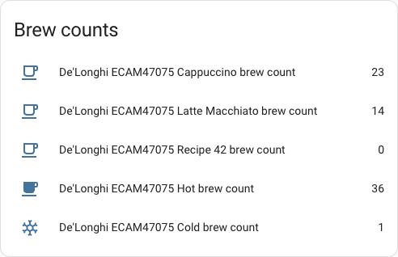

# Brew counts by drink

With read-only cloud telemetry enabled, Home Assistant can show how many times your machine has brewed a particular recipe and how many preparations it classifies as hot or cold. These counters share the existing brewing statistics request, normally refreshed about every 15 minutes.

## Choose the drinks on your dashboard

1. In **Settings → Devices & services**, open your De’Longhi My Coffee Lounge device. If needed, open the integration’s **Configure** dialog and enable **Read-only cloud telemetry**.
2. On the device page, expand the disabled entities. Enable the recipe counters you want to track. A recipe gets a sensor after the machine first reports a valid count, including zero. The hot and cold counters are enabled by default when reported.
3. Edit your dashboard, add an **Entities** card and select your counters. To see how many coffees you prepare per day or week, choose an individual counter as the source of a [Utility Meter](https://www.home-assistant.io/integrations/utility_meter/).

## PrimaDonna Aromatic ECAM630.70

| Recipe ID | Verified drink |
| ---: | --- |
| 1 | Espresso |
| 15 | Cappuccino Mix |

One preparation of each drink increased its recipe counter by one. The Cappuccino Mix test also increased the machine’s hot brew total by one.

## Reading the counters

On the Eletta Ultra ECAM470.75.TXB, the owner verified the names Cappuccino, Latte Macchiato, Café con Leche, Caffè Crema, Black Eye and Iced Latte Macchiato. Home Assistant uses these labels when it recognizes the product model. For other models, unmapped drinks, or older installations reporting only a numeric display-board identifier, the sensor shows the recipe ID, such as **Recipe 42 brew count**. [Eletta Ultra observations](https://github.com/sk7n4k3d/delonghi-daedalus-ha/issues/8)

You can rename a sensor on its entity page. Its identity uses the machine and recipe ID, so adding a verified display name in a later release preserves the entity and its history.

The hot and cold totals come directly from the machine. A reported zero appears as **0**. If a previously reported counter disappears from the statistics, its sensor becomes **Unavailable** until a valid count returns. A lifetime count can include preparations made before Home Assistant was installed.

Home Assistant registers up to 256 distinct recipe counters per machine. Previously registered recipes keep their place, including recipes you have renamed or disabled.
