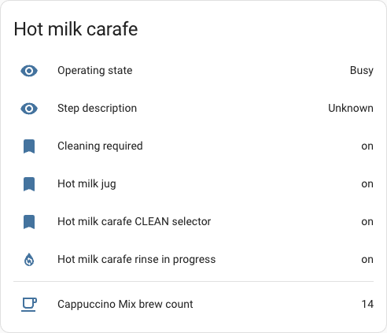

# Hot milk carafe dashboard

See the PrimaDonna Aromatic ECAM630.70's reported preparation and hot milk carafe activity
in a built-in Home Assistant Entities card. The card reads existing cloud telemetry. Use the
machine's display to select a drink, change its settings or follow cleaning instructions.

## Add the card

1. Enable **Read-only cloud telemetry** for the My Coffee Lounge integration. [Setup guide](daedalus-setup.md)
2. Open the machine's device page in **Settings → Devices & services**. The two raw
   carafe diagnostics are disabled by default. To include them, expand the disabled entities
   and enable **Hot milk jug** and **Hot milk carafe CLEAN selector** if listed. Enable
   **Cappuccino Mix brew count** if you want the recipe counter.
3. Edit the dashboard, add a **Manual** card and paste the example YAML. Replace every
   `example_` entity ID with the ID shown on your machine's device page or in
   **Developer tools → States**. The selector can have `hot_cleaning_cycle` in its ID and
   the Cappuccino Mix counter can have `recipe_15` in its ID. Remove rows for entities your
   machine has yet to report or that you choose to omit.
   [Card YAML](daedalus-hot-carafe-card.yaml)

If an older entry still shows **Recipe 15 brew count** or **Hot cleaning cycle**, open
the integration entry's menu, choose **Reconfigure** and confirm your existing connection
settings. This lets the integration look up a missing product model in your account and
reload the labels. Home Assistant keeps the entity IDs and any names you set yourself.

## Read the observations

| Entity (English name) | What it reports |
| --- | --- |
| Operating state | The machine's reported state, such as **Busy** or **Idle**. |
| Step description | The reported step, which can display **Coffee Delivery**, **Steam Delivery** or **Unknown**. |
| Cleaning required | A general cleaning request. Carafe rinsing is one possible reason on the Aromatic. Check the machine's display for the instructions. |
| Hot milk jug | Whether the machine reports the hot carafe attached. |
| Hot milk carafe CLEAN selector | On the Aromatic, whether the machine reports the hot carafe selector in the **CLEAN** position. |
| Hot milk carafe rinse in progress | On the ECAM630.70, the integration's interpretation of the reported operating state, mode, carafe presence and selector position. Ambiguous or missing readings make this entity **Unavailable**. |
| Cappuccino Mix brew count | The lifetime count for recipe 15 as reported by the machine. |

**Brew unit cleaning required** is a separate alarm for cleaning the brew unit. Removing the
carafe changes the presence reading. A clearing alarm or a change in selector position alone
does not establish that a rinse completed.

Home Assistant polls status about every two minutes. A poll can miss intermediate phases or
an entire rinse, so use the machine's display to check completion. The counters normally refresh
about every 15 minutes. A supported entity can appear once its field is first reported. Treat
**Unknown**, **Unavailable** or a missing entity as missing information about the operation.
[Interpreting availability](daedalus-setup.md#interpreting-availability)

In a field check, selecting **L (275 mL)** and **intensity 3** on the machine and preparing a
Cappuccino Mix increased recipe count **15** by one. An Espresso increased recipe count **1** by
one. [Brew counts by drink](daedalus-drink-statistics.md)
